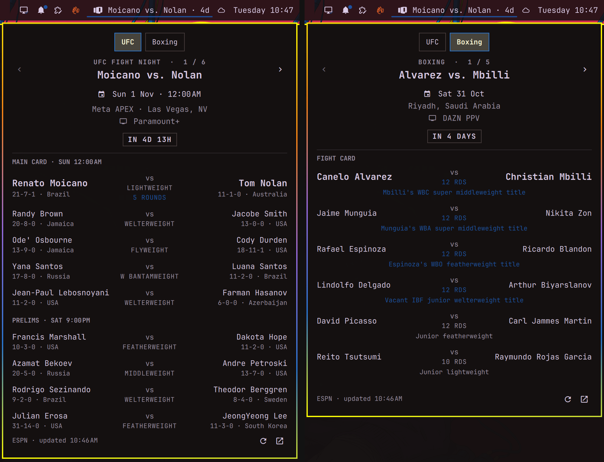

# OmaCombat

The next UFC event in your Omarchy bar. Click it for the full fight card, step
through every upcoming event with the arrows, and switch to the big boxing
fights coming up.



- **Bar pill** with the headliners and a countdown to the main card
  (`Moicano vs. Nolan · 6d`), turning to `LIVE` in the urgent colour once the
  first bout starts. Short on bar space? Switch to the **icon** style: just
  the glove, which fills with your theme's urgent colour while an event is on.
- **Fight card popup** with the date and time in your time zone, venue,
  broadcaster, and every bout split into main card, prelims and early prelims,
  with records, countries, weight classes and five-round fights marked.
- **Browse ahead** through every scheduled event with ‹ › or `h` / `l`.
- **Live results**: while an event is on, it refreshes every two minutes and
  highlights each winner as bouts finish.
- **Boxing**: a switch at the top of the popup (or `b`) lists the big boxing
  fights coming up, with the date, city, broadcaster, rounds and the titles on
  the line for every bout on the card. UFC is always where it opens.
- **A secret**, for anyone who spent 1985 in an arcade: the popup knows a
  certain famous code.

## Install

```bash
omarchy plugin add https://github.com/leewynne/omacombat.git --enable
```

The widget lands in the right section of the bar. Move it with
`omarchy bar move leewynne.omacombat --section center` or by dragging it.

Requires an Omarchy release with the plugin shell (`omarchy plugin`) and
`curl`, which Omarchy ships.

### Coming from Next UFC

OmaCombat is Next UFC renamed, with boxing added. It has a new plugin id, so
swap one for the other and set your bar label again if you'd changed it:

```bash
omarchy plugin remove leewynne.next-ufc
omarchy plugin add https://github.com/leewynne/omacombat.git --enable
omarchy bar set leewynne.omacombat label icon
```

## Use

| Action | Does |
|---|---|
| Left click | Open the fight card |
| Middle click | Refresh |
| Right click | Open the next UFC event on ESPN |

Inside the popup: `u` and `b` switch between UFC and boxing, `←` `→` or `h`
`l` change event, `↑` `↓` or `j` `k` scroll the card, `Enter` opens the event
on ESPN, `r` refreshes, `Esc` closes, and `Tab` moves to the neighbouring bar
panel.

It can also be driven over IPC, for a keybinding for instance:

```bash
omarchy-shell shell toggle leewynne.omacombat '{}'
omarchy-shell leewynne.omacombat ufc
omarchy-shell leewynne.omacombat boxing
omarchy-shell leewynne.omacombat next
omarchy-shell leewynne.omacombat previous
omarchy-shell leewynne.omacombat refresh
```

## Settings

Change these from the bar settings, or with `omarchy bar set`:

```bash
omarchy bar set leewynne.omacombat label icon
omarchy bar set leewynne.omacombat boxing titles
omarchy bar set leewynne.omacombat clock 24h
omarchy bar set leewynne.omacombat refreshMinutes 60 --json
```

| Key | Values | Default |
|---|---|---|
| `label` | `fighters` (`Gane vs. Hokit · 6d`) or `icon` (the glove alone) | `fighters` |
| `boxing` | `big` (ESPN's key dates), `titles` (every card with a world title fight), `all` (ESPN's full schedule) or `off` (no boxing tab) | `big` |
| `clock` | `locale`, `24h`, `12h` | `locale` |
| `refreshMinutes` | 5–240 | `30` |

## Data

UFC schedules, cards and results come from ESPN's public UFC scoreboard
(`site.api.espn.com`). Boxing comes from ESPN's
[boxing schedule](https://www.espn.com/boxing/story/_/id/12508267/boxing-schedule),
read through ESPN's news API (`now.core.api.espn.com`). That story lists dates
but not start times, so boxing cards show the day only, and it has no results.

The plugin makes one request to each every `refreshMinutes` (the UFC one every
two minutes while an event is live) and sends nothing else. No account or API
key is needed.

ESPN's feeds are undocumented and the boxing schedule is written by hand, so
either could change; if a tab stops loading, please open an issue.

UFC is a registered trademark of Zuffa, LLC. This plugin is a fan project and
is not affiliated with, endorsed or sponsored by the UFC, Zuffa, TKO, ESPN or
any boxing promoter or sanctioning body.

Yie Ar Kung-Fu is Konami's. The tribute hidden in this plugin uses original
art, rules and code, contains nothing from Konami's games, and is not
affiliated with or endorsed by Konami.

## Remove

```bash
omarchy plugin remove leewynne.omacombat
```

This removes the plugin folder and its bar entry. It stores nothing else.

## Develop

```bash
./tests/run
```

The model (`Model.js`) and the game (`Arcade.js`) are plain JavaScript shared
by the QML and the node tests. `tests/fixtures/scoreboard.json` is a trimmed
real ESPN UFC response and `tests/fixtures/boxing.json` a real copy of the
boxing schedule story.

The game's sound effects in `sounds/` are synthesised by `node tools/sfx.js`.
They play through Qt Multimedia when it's installed, or PipeWire's `pw-play`
when it isn't.

## License

MIT
